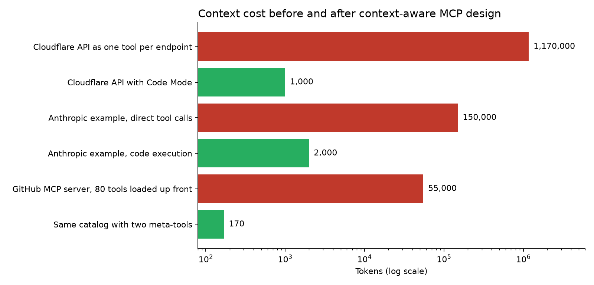

# MCP Performance, Context Efficiency, and an Open-Source Adoption Strategy

## Summary

MCP can make agents slower, more expensive, and less accurate, but the protocol itself is rarely the main cause. Measured protocol overhead is usually tens of milliseconds, while model inference takes seconds. The dominant costs come from three design choices: loading every tool definition into context up front, returning large raw results that the model must read and often re-read, and forcing the model to orchestrate many small sequential calls.

The answer to both questions is therefore yes, with a qualification:

- **Does MCP make agents slower?** Typical MCP designs do, mostly through extra tokens and extra model turns rather than transport latency.
- **Does MCP give agents unnecessary information?** Frequently. Large tool catalogs and raw JSON responses are the most consistently documented sources of waste.

Both problems are fixable at the server and client level. That makes them the strongest available positioning for a new open-source framework: not "an easier way to write MCP servers," which already exists, but "MCP servers that are measurably cheap, fast, and accurate for agents, with proof."

## Where the time and tokens actually go

### Protocol and transport overhead is small

A Microsoft comparison of MCP and CLI tool integration reports MCP protocol overhead of roughly 50 ms for local stdio and up to 200 ms for remote HTTP. The authors describe this as noticeable for a single file read but negligible relative to LLM inference in workflows with 20 or more tool calls ([Malik et al., arXiv](https://arxiv.org/pdf/2610.30157v1)). An independent benchmark measured median stdio framing latency around 2.3 ms and remote HTTP around 18.7 ms, and concludes that real-world tool latency depends mainly on downstream databases and APIs ([MCP Codex benchmarks](https://mcp-codex.com/articles/mcp-server-benchmarks-2025)). These figures come from different setups and should be treated as order-of-magnitude evidence, not a standard.

The ProMCP profiling study reaches a consistent conclusion: across the evaluated configurations, actual tool execution was a negligible fraction of total cost, while LLM planning and answer phases dominated latency ([Anjum et al., ACL Findings 2026](https://aclanthology.org/2026.findings-acl.1967.pdf)).

The practical implication is that optimizing JSON-RPC parsing or switching languages will produce little end-to-end improvement. Reducing tokens and model turns will.

### Tool definitions consume context before the user asks anything

Most clients historically loaded all tool definitions up front, which increases response time and cost; with many connected tools, an agent may process hundreds of thousands of tokens before reading the request ([Anthropic Engineering](https://www.anthropic.com/research/code-execution-with-mcp)). The official MCP client guidance states that loading every definition up front wastes tokens, increases latency, and degrades model performance ([MCP client best practices](https://modelcontextprotocol.io/docs/2026-07-28/develop/clients/client-best-practices)).

Measured examples:

| Case | Measured cost | Source |
| --- | --- | --- |
| GitHub-style server, about 80 tools at about 700 tokens each | About 55,000 tokens up front | [Malik et al.](https://arxiv.org/pdf/2610.30157v1) |
| 43-tool GitHub Copilot MCP on a trivial "repo language" task | 44,026 tokens versus 1,365 for the `gh` CLI | [GAX benchmark summary of Scalekit](https://github.com/0sparsh2/GAX/blob/main/mcp_vs_cli_benchmarks_2026/report.md) |
| Heavy single tools with nested schemas and long descriptions | About 1,000 tokens each, versus about 100 for simple tools | [MCP specification discussion #2812](https://github.com/modelcontextprotocol/modelcontextprotocol/discussions/2812) |
| 13 open-source servers, 79 tools | Median about 103 tokens per tool; GitHub MCP 3,546 tokens for 26 tools | [MCP specification discussion #2812](https://github.com/modelcontextprotocol/modelcontextprotocol/discussions/2812) |

The same discussion notes that prompt caching reduces the cost but not the context space consumed, and that adding or removing tools can evict the cache ([MCP specification discussion #2812](https://github.com/modelcontextprotocol/modelcontextprotocol/discussions/2812)). Context space matters beyond cost: tool selection tends to get worse as the list grows, which is why the maintainers made progressive discovery a roadmap priority ([MCP roadmap](https://blog.modelcontextprotocol.io/posts/mcp-roadmap/)).

### Tool results are often the larger problem

In multi-step tasks, results can outweigh definitions. In ProMCP's MCP-Universe runs, tool results accounted for 77.5% of tokens in a custom Claude client and 82.9% in Claude Desktop, which exceeded 1.2 million total tokens. The authors attribute this to web search output being retained and re-consumed across turns, and to the full raw JSON response, including metadata and auxiliary fields, being injected into context ([Anjum et al.](https://aclanthology.org/2026.findings-acl.1967.pdf)).

Anthropic describes the same pattern from a different angle: in direct tool calling, each result passes through the model before the next operation, so a meeting transcript copied from one system to another flows through the model twice and can add about 50,000 tokens ([Anthropic Engineering](https://www.anthropic.com/research/code-execution-with-mcp)). In a Scalekit example, listing GitHub issues returned about 3,000 output tokens of full objects through MCP versus about 200 through the CLI ([StackOne](https://www.stackone.com/blog/mcp-vs-cli-for-ai-agents/)).

### Reliability failures can look like performance failures

The widely cited Scalekit result that MCP "failed 28% of the time" deserves careful reading. The failures were connection timeouts to a remote Copilot MCP server; when connected, task outcomes were successful in both modes ([GAX benchmark summary](https://github.com/0sparsh2/GAX/blob/main/mcp_vs_cli_benchmarks_2026/report.md)). This is an operations problem, not a protocol property, but users experience it as "MCP is unreliable." A framework that wants broad trust must treat availability, timeouts, and fast failure as part of performance.

## What works: evidence for each optimization



The chart compares figures reported by different sources under different conditions; it illustrates magnitudes, not a controlled benchmark. Cloudflare reports its full API at about 1.17 million tokens as one tool per endpoint versus about 1,000 with Code Mode ([Cloudflare](https://blog.cloudflare.com/code-mode-mcp/)); Anthropic reports an example dropping from 150,000 to 2,000 tokens ([Anthropic Engineering](https://www.anthropic.com/research/code-execution-with-mcp)); and the Microsoft paper reports about 170 tokens for two progressive-disclosure meta-tools versus about 55,000 for a naive 80-tool catalog ([Malik et al.](https://arxiv.org/pdf/2610.30157v1)).

| Technique | What it fixes | Evidence | Trade-off |
| --- | --- | --- | --- |
| Progressive discovery (search, inspect, call) | Up-front catalog cost and poor tool selection | MCP guidance suggests switching once definitions exceed about 1–5% of context ([MCP client best practices](https://modelcontextprotocol.io/docs/2026-07-28/develop/clients/client-best-practices)); reported reductions of 71–99% ([Malik et al.](https://arxiv.org/pdf/2610.30157v1)) | Extra lookup turn; search quality must be evaluated |
| Code execution over typed APIs | Large catalogs, large intermediate results, long sequential chains | 99.9% input reduction for Cloudflare's API ([Cloudflare](https://blog.cloudflare.com/code-mode-mcp/)) | Requires a secure sandbox and careful authorization of every brokered call ([MCP client best practices](https://modelcontextprotocol.io/docs/2026-07-28/develop/clients/client-best-practices)) |
| Server-side filtering, pagination, and concise formats | Raw JSON dumps and repeated large results | Anthropic recommends high-signal fields, concise versus detailed formats, and pagination or truncation ([Anthropic tool guidance](https://www.anthropic.com/research/writing-tools-for-agents)) | Must leave a path to full detail when needed |
| Workflow-level tools instead of endpoint mirrors | Many small calls and many definitions | Anthropic recommends a small set of tools for high-impact workflows ([Anthropic tool guidance](https://www.anthropic.com/research/writing-tools-for-agents)) | Requires domain judgment; harder to auto-generate |
| Cacheable, deterministically ordered lists | Repeated discovery and prompt-cache churn | The 2026-07-28 specification adds `ttlMs`, `cacheScope`, and deterministic ordering ([MCP release notes](https://blog.modelcontextprotocol.io/posts/2026-07-28/)) | Private results must never cross authorization contexts ([MCP caching](https://modelcontextprotocol.io/specification/2026-07-28/server/utilities/caching.md)) |
| Structured, actionable errors | Wasted retry turns | Typed MCP errors cost an estimated 100–300 tokens per retry versus 300–1,200 for CLI ([Malik et al.](https://arxiv.org/pdf/2610.30157v1)) | Error messages need deliberate writing |

### MCP versus CLI is the wrong framing

Benchmarks favoring the CLI are real for local developer tools that models already know, such as `git`, `gh`, and `kubectl`. MCP is the better fit for remote SaaS that needs OAuth, multi-tenant credentials, runtime discovery, and normalized data across providers; most production agents use both ([StackOne](https://www.stackone.com/blog/mcp-vs-cli-for-ai-agents/)). The Microsoft paper reaches a similar conclusion, with CLI winning on setup, speed, and cost for simple local tasks and MCP winning on security and governance, breaking even near five users or with regulated data ([Malik et al.](https://arxiv.org/pdf/2610.30157v1)).

A framework does not need to win this argument. It needs to make MCP servers as lean as a good CLI where possible, while retaining MCP's authorization and governance advantages.

## Existing coverage

Some of these optimizations already exist. FastMCP provides search transforms that replace the full tool list with a search tool and a call proxy, plus an experimental Code Mode transform ([FastMCP search transforms](https://gofastmcp.com/docs/python-sdk/fastmcp-server-transforms-search-base), [FastMCP transforms](https://gofastmcp.com/servers/transforms/transforms)). Cloudflare offers Code Mode MCP servers and portals that collapse upstream tools into search and execute ([Cloudflare Agents docs](https://developers.cloudflare.com/agents/model-context-protocol/guides/build-codemode-mcp-server/), [Cloudflare MCP portals](https://developers.cloudflare.com/cloudflare-one/access-controls/ai-controls/mcp-portals/)). Claude's platform supports native tool search for loading definitions on demand ([Claude tool search](https://platform.claude.com/docs/en/agents-and-tools/tool-search-tool)).

What is missing is not any single technique but **measurement and enforcement**. No widely adopted tool tells a developer, before release, how many tokens their server costs, which tool is bloated, how much context a typical task consumes, or whether a change made the agent slower or less accurate. Progressive discovery also has no specification proposal yet; it is a stated direction rather than something to build against ([One](https://www.withone.ai/blog/mcp-roadmap-progressive-discovery-one-mcp)).

## Design principles for a fast, low-noise framework

### Make budgets a build-time contract

Every capability should declare a context budget, and the framework should measure it automatically:

- **Definition budget:** Token count of each tool's name, description, and schema, reported per tool and per server. Fail CI when a tool or server exceeds its budget.
- **Response budget:** A default maximum per result, with truncation that tells the model what was omitted and how to fetch more.
- **Task budget:** In evaluations, total tokens, turns, and wall-clock time to complete realistic tasks.

Because schema size drives most definition cost, the framework should actively flag the usual causes: long parameter descriptions, deep nesting, duplicated enums, and unused optional fields ([MCP specification discussion #2812](https://github.com/modelcontextprotocol/modelcontextprotocol/discussions/2812)).

### Return the least information that answers the question

- **Concise by default:** Return semantic fields, not full upstream objects; offer a `detail` option when identifiers are needed for follow-up calls.
- **Filter at the source:** Push filtering, field selection, and aggregation into the server rather than into the model.
- **Large results by reference:** Return a summary plus an opaque handle that a follow-up call can page through, instead of dumping thousands of rows.
- **Strip transport noise:** Never forward headers, pagination metadata, or auxiliary fields the model does not need; ProMCP shows raw JSON injection inflating tool-result tokens ([Anjum et al.](https://aclanthology.org/2026.findings-acl.1967.pdf)).

### Scale the catalog automatically

The framework should choose a discovery mode from measured size rather than developer guesswork:

1. **Small servers:** Expose tools directly when definitions fit within the budget.
2. **Large servers:** Switch to search, inspect, and call once definitions exceed the threshold, consistent with the 1–5% guidance ([MCP client best practices](https://modelcontextprotocol.io/docs/2026-07-28/develop/clients/client-best-practices)).
3. **Very large APIs:** Offer an opt-in Code Mode with a sandbox, with no network or credential access for generated code, and authorization checks on every brokered call ([MCP client best practices](https://modelcontextprotocol.io/docs/2026-07-28/develop/clients/client-best-practices)).

Keeping the exposed meta-tools stable also protects prompt caches, since adding or removing definitions can invalidate a provider's cached prefix ([MCP client best practices](https://modelcontextprotocol.io/docs/2026-07-28/develop/clients/client-best-practices)).

### Reduce turns, then latency

- **Composite operations:** Let one call accomplish a common multi-step workflow, which removes model turns, the dominant latency cost.
- **Parallel-safe reads:** Mark read-only, independent tools so clients can call them concurrently.
- **Operational speed:** Reuse connections, avoid cold starts on remote deployments, honor `ttlMs` caching, and bound every call with a deadline so failures are fast and explicit ([MCP cancellation](https://modelcontextprotocol.io/specification/2026-07-28/basic/patterns/cancellation.md)).

### Explain everything to developers

Developers distrust what they cannot see. The framework should include:

- **A context view:** Exactly what the model received for each tool definition and result, with token counts.
- **A trace view:** Each call's latency breakdown, retries, errors, and truncation decisions.
- **Readable reports:** A plain summary such as "This server costs 2,140 tokens at startup; `search_orders` accounts for 41%; typical tasks complete in 3 turns."

## Open-source adoption strategy

### What the Jev launch actually shows

Jev is TypeSafe AI's typed decision model, released in early access on 15 September 2026; it is a closed API, not an open-source project ([Firecrux](https://firecrux.com/blog/typed-decision-models-jev/)). Its reception rested on a narrow, concrete promise: typed decisions in 70–500 ms, a claimed 40–200 times faster than frontier models, at very low input prices; demand was high enough that TypeSafe temporarily could not serve its API ([Firecrux](https://firecrux.com/blog/typed-decision-models-jev/)).

The open-source lesson comes from what happened next. The first open rebuild appeared on Hugging Face the next day, and within nine days an open 4B rebuild ranked above Jev on an independent composite benchmark, largely on speed and cost ([VRAM Calculator](https://vramcalculator.com/open-source-jev/)). One rebuild reported about 25,500 GitHub stars within about ten days ([VRAM Calculator](https://vramcalculator.com/open-source-jev/)). Independent tests also produced more qualified results than the launch claims, such as Jev scoring lower than Claude Haiku on a single-question phishing test but higher when the task was decomposed ([Firecrux](https://firecrux.com/blog/typed-decision-models-jev/)).

The transferable pattern is:

- **A new shape, not a better version:** Jev was not a faster chatbot; it was a different kind of tool for a common task.
- **One number people can repeat:** Speed and cost multiples spread because they are easy to quote.
- **Fast independent verification:** The community could test and rebuild it within days, and benchmarks drove the conversation.
- **Honest limits survive scrutiny:** Claims that later get qualified damage trust; a launch should publish its own caveats.

### Recommended wedge: audit before framework

Adoption is easier when people get value before changing their code. The strongest entry point is an **audit command that works against any existing MCP server**, regardless of which framework built it:

```text
npx ouncemcp audit https://example.com/mcp

Startup context:   44,026 tokens (43 tools)       FAIL  budget 4,000
Largest tools:     create_issue 1,380 · update_pr 1,210 · search_code 1,050
Median result:     3,100 tokens                   WARN  raw upstream objects
Suggested mode:    progressive discovery          est. startup 180 tokens
Report:            ./ouncemcp-report.html
```

The command name and numbers are illustrative. The point is that every server maintainer can run it in seconds, the results are shareable, and each report naturally points to the framework as the fix. A public leaderboard of popular servers' context costs, published with methodology and reproducible scripts, would create the repeatable number that drove Jev's spread.

### Release sequence

| Phase | Deliverable | Success signal |
| --- | --- | --- |
| 1. Measure | Audit CLI, token counter, and published methodology | Maintainers run it on their own servers and share reports |
| 2. Prove | Benchmark of 10–20 popular servers, before and after optimization, with tokens, turns, latency, and task success | Results reproduced independently |
| 3. Fix | Lightweight framework layer on FastMCP and the TypeScript SDK with budgets, response shaping, and auto discovery mode | Existing servers adopt it with small changes |
| 4. Expand | Agent evaluation kit, trace viewer, and CI integration | Projects add the budget check to their pipelines |

Building on existing SDKs rather than replacing them keeps the project compatible and lowers adoption friction, which matters more for reach than owning the whole stack.

### Risks to manage

- **Accuracy regressions:** Aggressive trimming can remove information the model needs; every optimization must be validated by task success, not tokens alone.
- **Client variation:** Hosts handle definitions and results differently, as ProMCP's Claude Desktop results show ([Anjum et al.](https://aclanthology.org/2026.findings-acl.1967.pdf)); benchmarks must name the client and model.
- **Moving target:** The roadmap may standardize progressive discovery and a single tool-result contract ([MCP roadmap](https://blog.modelcontextprotocol.io/posts/mcp-roadmap/)); the framework should track and adopt standards rather than compete with them.
- **Security in Code Mode:** Sandboxed code execution expands the attack surface and must remain opt-in with strict brokered authorization.
- **No guarantee of virality:** Adoption depends on evidence, timing, and community response; the plan maximizes the chance by making value measurable and shareable.

## Conclusion

MCP's protocol overhead is small; the waste comes from oversized catalogs, oversized results, and too many model turns. All three are fixable with known techniques, but no widely used tool measures and enforces them. A framework built around explicit context budgets, concise results, automatic discovery modes, and transparent traces would address the real performance problem. Releasing an audit tool first, backed by a reproducible public benchmark, offers the clearest path to the kind of rapid, evidence-driven community adoption seen around Jev.
