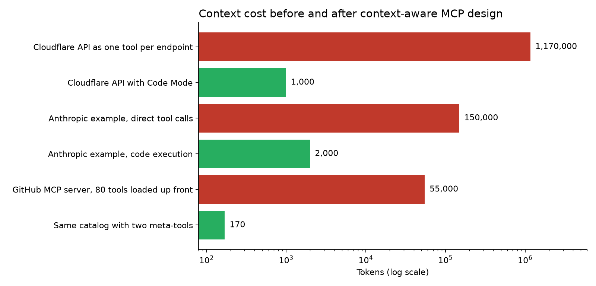

# OunceMCP: building an effective MCP server and client framework

Project specification

| Field | Value |
| --- | --- |
| Project name | **OunceMCP**. Package and CLI: `ouncemcp`; Python import: `ouncemcp`. The name was free on PyPI, npm, and GitHub on 9 November 2026; reserve it before announcing |
| Document type | Project specification, version 0.5 (SEC-12, BUD-6, BUD-7 and BUD-9 merged, discovery modes in review) |
| Date | 10 November 2026 |
| Target protocol | MCP specification `2026-07-28`, with tested legacy compatibility |
| Reference implementation | Python, built on FastMCP 4 and the official MCP Python SDK |
| License (proposed) | Apache-2.0 |
| Status | M0 done ([M0 report](m0-report.md)). M1 in progress: RES-8 to RES-10 and PERF-7 are merged ([PR #3](https://github.com/subbusainath/ouncemcp/pull/3), [PR #4](https://github.com/subbusainath/ouncemcp/pull/4)). SEC-12 is merged ([PR #7](https://github.com/subbusainath/ouncemcp/pull/7)). BUD-6 is merged ([PR #8](https://github.com/subbusainath/ouncemcp/pull/8)). BUD-7 (declared scope) and BUD-9 are merged ([PR #9](https://github.com/subbusainath/ouncemcp/pull/9)). Discovery modes DISC-1 to DISC-5 and DISC-7 are implemented in [PR #10](https://github.com/subbusainath/ouncemcp/pull/10), open for review, with a recall hook for DISC-6. Next: the BUD-7 host study. See section 15.3 |
| Repository | [github.com/subbusainath/ouncemcp](https://github.com/subbusainath/ouncemcp) (private), default branch `main`, last merge `bd30be6` (PR #9) |

This specification turns two research investigations into a buildable plan. Protocol facts are cited to primary sources. Requirements, default limits, interfaces, and milestones are proposals and are marked as such; numeric defaults must be validated experimentally before being presented as recommendations to users.

**Change in version 0.2.** The framework is the product. Auditing is an optional command (section 8.6) rather than the first deliverable, and the roadmap, goals, and launch plan are reordered accordingly. The project is named OunceMCP, replacing the placeholder `mcp-lean`, which conflicted with an existing npm package and the LeanMCP brand.

**Change in version 0.3.** The M0 prototype found five limitations: the text-only fallback breaks the output-schema contract, page trimming leaves gaps behind cursors, cursors are unsigned, the tokenizer is fixed, and what hosts show the model is unverified. Version 0.3 adds requirements for each (RES-8 to RES-11, SEC-12, BUD-6 to BUD-9, PERF-7), adds them to the M1 scope and exit criteria, and records the mapping in section 15.2.

**Change in version 0.4.** M1 work has started. RES-8, RES-9, RES-10 and PERF-7 are implemented, tested and merged, and RES-4's fixed note reserve has been replaced by the note's measured size. Section 15.3 records the implementation status, public API, commands and next tasks, so work can continue in another tool (Cursor, the Claude app, or a new session) from this document alone. Design detail is in [proposal 0002](proposals/0002-schema-safe-shaping-and-pagination.md).

**Change in version 0.5.** SEC-12 is implemented in [PR #7](https://github.com/subbusainath/ouncemcp/pull/7): `ctx.page`, `ctx.offset` and `ctx.window` now issue HMAC-signed `s1.` cursors that are bound to the tool, the caller and the query arguments, expire, and support key rotation. Section 15.3 is updated to match. Design detail is in [proposal 0003](proposals/0003-signed-cursors.md). PR #7 is merged into `main`.

**Requirement keywords.** MUST, SHOULD, and MAY in the requirement tables are this project's internal requirements, not MCP specification requirements, unless a citation states otherwise. Priorities: **P0** is required for the first public release, **P1** for the 1.0 release, and **P2** is planned later.

---

## 1. Vision

**Make the fast, low-noise, safe MCP server the easiest one to build, and prove it with numbers.**

`ouncemcp` is an open-source **framework for building MCP servers and clients** that are fast, low-noise, and safe for agents by default. It sits on top of FastMCP and adds what agents need but most servers lack:

1. **The framework core:** typed capabilities with declared effects, context budgets, automatic discovery modes, response shaping, agent-friendly errors, and explicit security and execution policy.
2. **Developer tooling:** `init`, `dev`, `check`, and `context`, so developers see exactly what the model receives and what it costs while they build.
3. **A reference client:** a broker that connects agents to many servers without context bloat.
4. **An evaluation kit:** conformance, security, and agent task tests that prove the framework improves results.
5. **An optional audit command:** measures any MCP server, including ones not built with `ouncemcp`. Useful, but never required.

The one-sentence promise for the community: **"OunceMCP: every token counts. Build MCP servers that agents can use fast and cheaply, by default."**

---

## 2. Problem statement

### 2.1 MCP often makes agents slower and noisier, but rarely because of the protocol

Protocol overhead is small. A Microsoft study reports about 50 ms for local stdio and up to 200 ms for remote HTTP, negligible relative to LLM inference in workflows with 20 or more calls ([Malik et al., arXiv](https://arxiv.org/pdf/2610.30157v1)). The ProMCP profiling study found tool execution to be a negligible fraction of total cost, with LLM planning and answer phases dominating latency ([Anjum et al., ACL Findings 2026](https://aclanthology.org/2026.findings-acl.1967.pdf)).

The real costs come from three design patterns:

| Cause | Evidence |
| --- | --- |
| Loading every tool definition up front | An 80-tool GitHub-style server costs about 55,000 tokens before any user request ([Malik et al.](https://arxiv.org/pdf/2610.30157v1)); a 43-tool server used 44,026 tokens on a trivial task versus 1,365 for the `gh` CLI ([GAX summary of Scalekit](https://github.com/0sparsh2/GAX/blob/main/mcp_vs_cli_benchmarks_2026/report.md)) |
| Returning large raw results | Tool results accounted for 77.5–82.9% of tokens in some multi-step runs, partly because full raw JSON was injected and re-read across turns ([Anjum et al.](https://aclanthology.org/2026.findings-acl.1967.pdf)) |
| Forcing the model to chain many small calls | Each intermediate result passes through the model; a meeting transcript copied between systems can add about 50,000 tokens ([Anthropic Engineering](https://www.anthropic.com/research/code-execution-with-mcp)) |

Context size also affects accuracy, not only cost. The official guidance says loading every definition up front wastes tokens, increases latency, and degrades model performance ([MCP client best practices](https://modelcontextprotocol.io/docs/2026-07-28/develop/clients/client-best-practices)), and the maintainers note tool selection tends to worsen as the list grows ([MCP roadmap](https://blog.modelcontextprotocol.io/posts/mcp-roadmap/)).

### 2.2 The fixes are known but not measured or enforced



The chart compares figures from different sources under different conditions and illustrates magnitude only. Cloudflare reports about 1.17 million tokens as one tool per endpoint versus about 1,000 with Code Mode ([Cloudflare](https://blog.cloudflare.com/code-mode-mcp/)); Anthropic reports 150,000 reduced to 2,000 ([Anthropic Engineering](https://www.anthropic.com/research/code-execution-with-mcp)); and the Microsoft paper reports about 170 tokens for two progressive-disclosure meta-tools versus about 55,000 for a naive catalog ([Malik et al.](https://arxiv.org/pdf/2610.30157v1)).

Some techniques already exist in frameworks: FastMCP provides search transforms and an experimental Code Mode transform ([FastMCP search transforms](https://gofastmcp.com/docs/python-sdk/fastmcp-server-transforms-search-base), [FastMCP transforms](https://gofastmcp.com/servers/transforms/transforms)). What is missing is a framework that makes these techniques the default rather than opt-in extras, enforces budgets before release, and shows developers how much their server costs an agent, which tool is responsible, and whether a change made agents slower or less accurate. Protocol-level progressive discovery also has no specification proposal yet ([One](https://www.withone.ai/blog/mcp-roadmap-progressive-discovery-one-mcp)).

### 2.3 Correctness and safety are also under-served

Basic registration, composition, and multi-server clients are well covered ([FastMCP providers](https://gofastmcp.com/docs/servers/providers/overview), [mcp-use server](https://docs.mcp-use.com/typescript/server)). Harder problems remain largely left to each developer: safe retries of writes, verified authorization, tenant-isolated caching, and task-level evaluation. These are covered in sections 8.2 and 10.

---

## 3. Goals and non-goals

### 3.1 Goals

| ID | Goal | Measured by |
| --- | --- | --- |
| G1 | Developers build a working, lean MCP server in under five minutes | Time from install to first passing local server (DX-8) |
| G2 | Servers built with `ouncemcp` use far fewer tokens than naive equivalents without lowering task success | Benchmark suite (section 13) |
| G3 | Correct, safe behavior is the default path | Release gates (section 14) |
| G4 | Developers understand exactly what the agent saw and why | Trace and context views (section 8.4) |
| G5 | Existing FastMCP servers adopt the framework with small changes | Lines changed in migration pilots |
| G6 | Results are reproducible by anyone | Published methodology and scripts |
| G7 | Developers can optionally measure any MCP server, whichever framework built it | `ouncemcp audit` report (section 8.6) |

### 3.2 Non-goals for 1.0

- A new MCP protocol implementation or transport stack.
- A custom OAuth or identity server.
- A hosted gateway, marketplace, or visual builder.
- Automatic conversion of every OpenAPI endpoint into a tool.
- Simultaneous SDKs in every language. A TypeScript port is considered after 1.0.
- A mandatory agent orchestration framework.
- Guarantees of identical behavior across every MCP host.

---

## 4. Users

| Persona | Need | Primary entry point |
| --- | --- | --- |
| Backend or cloud engineer exposing internal services | Build a fast, secure server quickly | `ouncemcp init` and the framework |
| Existing FastMCP server maintainer | Make an existing server leaner with small changes | Migration guide; optional `ouncemcp audit` to compare before and after |
| Platform or security team | Enforce budgets and policy in CI | `ouncemcp check` in pipelines |
| Agent or host developer | Connect to many servers without context bloat | Reference client |
| Researcher or evaluator | Compare servers reproducibly | Eval kit and benchmark harness |

The proposed initial audience is backend and cloud engineers who build new MCP servers in Python. Maintainers migrating existing servers are the second audience.

---

## 5. Product principles

1. **Lean by default, measured always.** The simplest way to write a tool is also the efficient way, and every claim about speed or size is backed by a reproducible measurement.
2. **Least information that answers the question.** Concise results by default; detail on request.
3. **Fewer turns beat faster transport.** Optimize model round trips before micro-optimizing the wire.
4. **Safe by default, explicit when risky.** Writes, approvals, and credentials require deliberate configuration.
5. **Nothing hidden.** Developers can see exactly what the model received.
6. **Build on standards.** Track the MCP specification and adopt official mechanisms when they arrive.
7. **Accuracy is the guardrail.** No optimization ships if it lowers task success.

---

## 6. Protocol baseline

### 6.1 Target revision

The current specification is `2026-07-28`, with a stateless core, per-request capabilities, and no initialization handshake or protocol session ([MCP specification](https://modelcontextprotocol.io/specification/2026-07-28), [release notes](https://blog.modelcontextprotocol.io/posts/2026-07-28/)). Compatibility contracts in this project MUST use the dated revision rather than labels such as "MCP 2.0."

| Area | Verified baseline | Implication for this project |
| --- | --- | --- |
| Request lifecycle | Modern requests are self-contained; servers must implement `server/discover` ([versioning](https://modelcontextprotocol.io/specification/2026-07-28/basic/versioning.md)) | No hidden connection state for domain data |
| Compatibility | Legacy revisions through `2025-11-25` use initialization; modern-only and legacy-only peers cannot interoperate ([versioning](https://modelcontextprotocol.io/specification/2026-07-28/basic/versioning.md)) | Legacy support stays in the adapter and is tested |
| Local transport | Stdio uses newline-delimited JSON-RPC with protocol-only stdout ([stdio](https://modelcontextprotocol.io/specification/2026-07-28/basic/transports/stdio.md)) | Supported; logs go to stderr |
| Remote transport | Streamable HTTP with required headers mirrored against the body ([HTTP transport](https://modelcontextprotocol.io/specification/2026-07-28/basic/transports/streamable-http.md)) | Delegated to the maintained SDK |
| Mid-call input | MRTR returns input requests and resumes through a new request ([MRTR](https://modelcontextprotocol.io/specification/2026-07-28/basic/patterns/mrtr.md)) | Continuations must be replay-safe |
| Caching | List and read results carry `ttlMs` and `cacheScope`; private results cannot cross authorization contexts ([caching](https://modelcontextprotocol.io/specification/2026-07-28/server/utilities/caching.md)) | Cache keys include authorization context |
| Tool errors | Execution errors use `isError: true`; protocol errors use JSON-RPC errors ([tools](https://modelcontextprotocol.io/specification/2026-07-28/server/tools.md)) | Error mapping is part of the runtime |
| Deprecations | Roots, Sampling, and Logging are deprecated; legacy HTTP+SSE is deprecated ([release notes](https://blog.modelcontextprotocol.io/posts/2026-07-28/)) | New features MUST NOT depend on them |

### 6.2 Foundation choice

FastMCP 4 runs on the MCP Python SDK v2, negotiates modern and legacy protocol eras per connection, and supports interactive input, caching hints, and optional tasks ([FastMCP 4 changes](https://gofastmcp.com/docs/getting-started/whats-new)). Building on it avoids reimplementing transport and composition. The project MUST pin exact FastMCP and SDK versions and recheck them each release.

---

## 7. System overview

```text
                    ┌──────────────────────────────────────────┐
                    │               ouncemcp CLI                │
                    │ init · dev · check · context              │
                    │ eval · bench · trace · audit (optional)   │
                    └────────────────────┬─────────────────────┘
                                         │
                                         ▼
               ┌──────────────────────────────────────────────────┐
               │                 Framework core                    │
               │ capabilities · budgets · discovery modes ·        │
               │ response shaping · errors · policy · execution    │
               │ token accounting (shared by check, dev, audit)    │
               └───────┬───────────────────┬──────────────────────┘
                       │                   │
                       ▼                   ▼
             ┌─────────────────┐   ┌──────────────┐  ┌────────────┐  ┌─────────────────┐
             │ FastMCP 4 /     │   │ Client broker│  │ Eval kit   │  │ Trace & context │
             │ MCP Python SDK  │   │              │  │            │  │ viewer          │
             └─────────────────┘   └──────────────┘  └────────────┘  └─────────────────┘
```

| Component | Package (proposed) | Role |
| --- | --- | --- |
| Framework core | `ouncemcp` | The product: build and run servers |
| Developer CLI (`init`, `dev`, `check`, `context`) | `ouncemcp` | Build-time feedback for framework users |
| Client broker | `ouncemcp[client]` | Connect agents to many servers efficiently |
| Eval kit and benchmark | `ouncemcp[eval]` | Prove behavior and efficiency |
| Trace viewer | `ouncemcp[ui]` | Inspect what the model saw |
| Audit command (optional) | `ouncemcp` CLI | Measure any server, including ones not built with `ouncemcp` |

The framework core is the center of the design. The client, eval kit, and audit command also work with servers built elsewhere, which makes migration and comparison easy, but they exist to support the framework rather than replace it.

### 7.1 Request pipeline (framework server)

```text
Transport request (FastMCP adapter)
  -> request size and nesting limits
  -> verified identity and request context
  -> capability visibility filter (authorization-scoped catalog)
  -> capability lookup and call authorization
  -> policy: approval, idempotency, effect checks
  -> bounded handler execution (deadline, cancellation)
  -> output validation
  -> response shaping (budget, fields, truncation, handles)
  -> safe result and error mapping
  -> transport response
       └─ redacted trace, token accounting, security event log
```

---

## 8. Functional requirements

### 8.1 Framework core

#### 8.1.1 Capability definition

| ID | Requirement | Priority | Acceptance criteria |
| --- | --- | --- | --- |
| CAP-1 | MUST define tools with typed inputs and outputs (Pydantic), description, handler, effect, and policy | P0 | Example in section 11 runs |
| CAP-2 | MUST support resources and prompts as separate primitives, as defined by MCP ([MCP specification](https://modelcontextprotocol.io/specification/2026-07-28)) | P1 | Resource and prompt examples pass conformance |
| CAP-3 | MUST declare an effect: `read`, `write`, or `destructive` | P0 | Missing effect fails registration |
| CAP-4 | MUST enforce tool naming rules: 1–128 characters, ASCII letters, digits, underscore, hyphen, and dot ([tools](https://modelcontextprotocol.io/specification/2026-07-28/server/tools.md)) | P0 | Invalid names rejected at startup |
| CAP-5 | MUST lint descriptions for purpose, when-not-to-use guidance, and side effects on writes | P1 | Linter rules with fixtures |
| CAP-6 | MUST NOT expose tenant identity, credentials, or approval state as model-controlled parameters | P0 | Registration rejects reserved parameter names; documented |
| CAP-7 | SHOULD support composite workflow tools that combine several service calls | P0 | Example composite tool with tests |

#### 8.1.2 Context budgets

Budgets are declared per server and per tool. The defaults below are **proposed starting points** derived from the evidence above and must be validated in the benchmark phase.

| Budget | Proposed default | Rationale |
| --- | --- | --- |
| Per-tool definition | Target 250, warn 500, fail 1,000 tokens | Median around 100 and heavy tools near 1,000 in measured servers ([MCP discussion #2812](https://github.com/modelcontextprotocol/modelcontextprotocol/discussions/2812)) |
| Server startup definitions | Warn 4,000; switch to discovery above the threshold in 8.1.3 | Guidance suggests switching at about 1–5% of the context window ([MCP client best practices](https://modelcontextprotocol.io/docs/2026-07-28/develop/clients/client-best-practices)) |
| Default result | 2,000 tokens | Keeps typical results small; detail available on request |
| Hard result ceiling | 8,000 tokens | Below the 25,000-token default limit Anthropic reports for Claude Code ([Anthropic tool guidance](https://www.anthropic.com/research/writing-tools-for-agents)) |

| ID | Requirement | Priority | Acceptance criteria |
| --- | --- | --- | --- |
| BUD-1 | MUST compute definition token counts at startup and in `ouncemcp check`, measured on definitions as an MCP client receives them (wire serialization and field order), not on in-process objects | P0 | Counts appear in `check` output and equal a recount of `tools/list` over stdio (done in M0) |
| BUD-2 | MUST fail `check` when a fail threshold is exceeded | P0 | CI exit code tests |
| BUD-3 | MUST enforce result budgets at runtime through response shaping (8.1.4) | P0 | Oversized results never exceed hard ceiling |
| BUD-4 | MUST allow overrides per tool with a recorded justification | P1 | Override without reason produces a warning |
| BUD-5 | SHOULD record actual token usage per call in traces | P0 | Trace includes result tokens |
| BUD-6 | MUST make the tokenizer pluggable: any tiktoken encoding, a custom counting callable, and provider token-counting APIs; every report MUST name the tokenizer used | P0 (interface and tiktoken), P1 (provider APIs) | Same server reported with two tokenizers; reports show the tokenizer name; provider adapter tested against a recorded response. **Interface, tiktoken encodings and custom callables done in M1** ([PR #8](https://github.com/subbusainath/ouncemcp/pull/8), merged): `get_counter` and `OunceServer(tokenizer=, tokenizer_name=)` take an encoding, a `TokenCounter` or a named function; `check`, `context`, `ServerCost`, results and too-large errors name the tokenizer. Provider APIs (P1) remain |
| BUD-7 | MUST state which definition fields are counted (name, description, input schema, output schema) and which are not (`title`, annotations, `_meta`); SHOULD record per host which fields reach the model | P0 (declared scope), P1 (per-host data) | `check --json` includes the counting scope; host findings published in the compatibility matrix. **Declared scope done in M1** ([PR #9](https://github.com/subbusainath/ouncemcp/pull/9), merged): `counting_scope` in `check --json`, `Counted` and `Not counted` lines in `check` and `context`, and `verified_hosts: []` until the host study. Per-host data (P1) remains |
| BUD-8 | MUST compact advertised schemas without changing what validation accepts: collapse optional `anyOf` with `null`, drop generated titles | P0 | Property test: every fixture input accepted by the Pydantic model is valid against the advertised schema and the reverse, apart from explicit `null` for optional fields, which the model still accepts |
| BUD-9 | MUST let servers and tools choose output schemas `on`, `off`, or `auto`, and `check` MUST report the output-schema share of definition tokens | P0 | Three modes tested; `check` shows the share (M0 inventory: 241 of 488 tokens). **Done in M1** ([PR #9](https://github.com/subbusainath/ouncemcp/pull/9), merged): `output_schemas=` on the server and `output_schema=` on a tool take `on` (default), `off` or `auto`; `auto` drops a schema only when it would put a definition over `Budget.tool_definition_target`; `check` reports `output_schema_tokens`, `output_schema_share` and per-tool fields (inventory: 241 of 488) |

#### 8.1.3 Automatic discovery mode

| Mode | When selected (proposed) | Exposed to the model |
| --- | --- | --- |
| `direct` | Startup definitions within budget | All visible tools |
| `search` | Startup definitions exceed budget | Pinned tools plus `search_tools`, `describe_tool`, and `call_tool` meta-tools |
| `code` (opt-in) | Very large APIs where developers explicitly enable it | `search` and `execute` in a sandbox, as in Cloudflare Code Mode ([Cloudflare](https://blog.cloudflare.com/code-mode-mcp/)) |

| ID | Requirement | Priority | Acceptance criteria |
| --- | --- | --- | --- |
| DISC-1 | MUST select `direct` or `search` automatically from measured cost, with explicit override | P0 | Mode switches at configured threshold. **Done in M1 ([PR #10](https://github.com/subbusainath/ouncemcp/pull/10)): `auto` compares measured `direct` tokens with `Budget.startup_tokens` and picks `search` only if it is smaller** |
| DISC-2 | MUST apply authorization before search results are returned | P0 | Unauthorized tools never appear in search. **Done in M1 ([PR #10](https://github.com/subbusainath/ouncemcp/pull/10)): search and `describe_tool` read FastMCP's auth-filtered catalog; tested at all three detail levels** |
| DISC-3 | MUST keep hidden tools callable only when authorized; hiding is not access control | P0 | Guessed-name call by unauthorized principal fails. **Done in M1 ([PR #10](https://github.com/subbusainath/ouncemcp/pull/10)): same `auth` check on direct and `call_tool` calls; unknown and unauthorized names get the same answer** |
| DISC-4 | MUST offer name-only, summary, and full-schema detail levels, as recommended ([MCP client best practices](https://modelcontextprotocol.io/docs/2026-07-28/develop/clients/client-best-practices)) | P0 | Three levels tested. **Done in M1 ([PR #10](https://github.com/subbusainath/ouncemcp/pull/10)): `name`, `summary`, `full` on `search_tools` and `describe_tool`** |
| DISC-5 | MUST keep meta-tool definitions stable to protect prompt caches ([MCP client best practices](https://modelcontextprotocol.io/docs/2026-07-28/develop/clients/client-best-practices)) | P0 | Definitions byte-identical across catalog changes. **Done in M1 ([PR #10](https://github.com/subbusainath/ouncemcp/pull/10)): built once, order fixed, tested across catalogs and pinned sets** |
| DISC-6 | MUST measure search recall in the eval kit so reduced tokens do not hide needed tools | P0 | Recall reported in eval output. **Partly done ([PR #10](https://github.com/subbusainath/ouncemcp/pull/10)): `server.measure_recall(cases)` reports recall at k; the eval kit does not exist yet, so reporting there is open** |
| DISC-7 | SHOULD build on FastMCP search transforms rather than reimplementing them | P0 | Implementation review. **Done in M1 ([PR #10](https://github.com/subbusainath/ouncemcp/pull/10)): `OunceSearchTransform` subclasses FastMCP's `BM25SearchTransform`** |
| DISC-8 | `code` mode MUST run generated code with no direct network or credential access and authorize every brokered call ([MCP client best practices](https://modelcontextprotocol.io/docs/2026-07-28/develop/clients/client-best-practices)) | P2 | Security test suite for sandbox escape and unauthorized calls |

#### 8.1.4 Response shaping

| ID | Requirement | Priority | Acceptance criteria |
| --- | --- | --- | --- |
| RES-1 | MUST support `concise` (default) and `detailed` response formats, following Anthropic's guidance ([Anthropic tool guidance](https://www.anthropic.com/research/writing-tools-for-agents)) | P0 | Both formats tested per example tool |
| RES-2 | MUST support field selection and server-side filtering declared in the output model | P0 | Unrequested fields absent |
| RES-3 | MUST paginate lists with bounded page sizes and stable cursors; a returned cursor MUST resume immediately after the last item actually returned. Cursors are opaque and an empty string is a valid cursor, following the MCP pagination rules ([pagination](https://modelcontextprotocol.io/specification/2026-07-28/server/utilities/pagination.md)) | P0 | Pagination tests, plus the RES-9 property test |
| RES-4 | MUST truncate over-budget results with a clear note of what was omitted and how to retrieve more; the note's measured size MUST be reserved from the budget (version 0.4 replaces the fixed 80-token reserve), the full note names at most three paths, a short note is used when the full note would exceed 10% of the budget, and every note ends with one recovery action | P0 | Truncation note present and accurate; result plus note within budget. **Done in M1** ([PR #4](https://github.com/subbusainath/ouncemcp/pull/4)) |
| RES-5 | SHOULD return large results by reference: a summary plus an opaque handle readable in pages | P1 | Handle bound to principal and expiry |
| RES-6 | MUST strip transport metadata and auxiliary upstream fields not declared in the output model, given evidence that raw JSON inflates tokens ([Anjum et al.](https://aclanthology.org/2026.findings-acl.1967.pdf)) | P0 | Output equals declared model |
| RES-7 | MUST return both structured content and a compact text rendering when an output schema exists ([tools](https://modelcontextprotocol.io/specification/2026-07-28/server/tools.md)) | P0 | Conformance passes |
| RES-8 | When an output schema is advertised, every successful result MUST include structured content that conforms to it, since MCP requires this of servers ([tools](https://modelcontextprotocol.io/specification/2026-07-28/server/tools.md)). Shaping MUST degrade in this order: trim lists (RES-10), shorten strings, drop optional fields. If the result still exceeds the budget, it MUST return a tool error (`isError: true`) with a short, actionable message such as asking for a smaller `limit`, rather than unstructured text. Text-only truncation is allowed only for tools without an output schema | P0 | Fuzz test over random outputs and budgets: every successful result validates against the advertised schema; over-budget minimal results return `isError` with a recovery hint. **Done in M1** ([PR #3](https://github.com/subbusainath/ouncemcp/pull/3)): every change is checked against the advertised schema; errors carry `reason` (`item_over_budget`, `min_items_over_budget`, `fixed_over_budget`) and suggest a lower `limit` only when it can help ([PR #4](https://github.com/subbusainath/ouncemcp/pull/4)) |
| RES-9 | MUST provide budget-aware pagination: a `ctx.page(rows, cursor=..., limit=...)` helper (settled in proposal 0002, with `Paginated` and `Cursor` field markers) that keeps as many items as fit the remaining result budget and builds the cursor from the last kept item. When the framework trims a list that a handler paginated itself, it MUST warn in the note that the cursor skips the removed items and give a `limit` that pages without gaps | P0 | Property test: for any data set, page size, and budget, following cursors returns every item exactly once. **Done in M1** ([PR #3](https://github.com/subbusainath/ouncemcp/pull/3)) |
| RES-10 | MUST NOT trim a non-empty list to zero items; the minimum is configurable per tool (default 1), and an oversized single item is shortened instead of dropped | P0 | Test with one item larger than the budget (fixed in M0); `min_items` per tool, default 1, values below 1 rejected. **Done in M1** ([PR #3](https://github.com/subbusainath/ouncemcp/pull/3)) |
| RES-11 | SHOULD let handlers skip expensive work for fields that will not be returned, by exposing the response format and remaining budget on the context | P1 | Example tool that skips a detail lookup in concise mode |

#### 8.1.5 Errors and execution

| ID | Requirement | Priority | Acceptance criteria |
| --- | --- | --- | --- |
| ERR-1 | MUST map errors into categories: validation, authentication, permission, not found, rate limit, transient, ambiguous write, internal | P0 | Each category has a test |
| ERR-2 | MUST return actionable, short validation messages that state how to correct the input | P0 | Messages under a configured length |
| ERR-3 | MUST NOT expose stack traces, secrets, or internal hostnames | P0 | Redaction tests |
| EXE-1 | MUST enforce a deadline on every call and propagate cancellation to upstream calls ([cancellation](https://modelcontextprotocol.io/specification/2026-07-28/basic/patterns/cancellation.md)) | P0 | Timeout tests |
| EXE-2 | MUST retry only transient read failures, with bounded backoff inside the deadline | P0 | No automatic write retries |
| EXE-3 | MUST report ambiguous status for write timeouts unless idempotency resolves them | P0 | Fault-injection test |
| EXE-4 | MUST provide an idempotency mechanism for writes, keyed by principal, tenant, operation, and normalized argument digest | P1 | Duplicate replay produces one effect |
| EXE-5 | MUST mark read-only, independent tools as parallel-safe for clients | P1 | Metadata present |
| EXE-6 | MUST bound request size, nesting depth, output size, and concurrency per principal | P0 | Limit tests |

### 8.2 Security and policy

| ID | Requirement | Priority | Acceptance criteria |
| --- | --- | --- | --- |
| SEC-1 | MUST derive identity from verified credentials only; self-reported client identity MUST NOT drive decisions ([base protocol](https://modelcontextprotocol.io/specification/2026-07-28/basic/index.md)) | P0 | Spoofed `clientInfo` has no effect |
| SEC-2 | MUST enforce policy on both catalog visibility and direct calls | P0 | See DISC-3 |
| SEC-3 | MUST treat tool annotations as hints, not enforcement ([MCP specification](https://modelcontextprotocol.io/specification/2026-07-28)) | P0 | Policy engine ignores annotations for access decisions |
| SEC-4 | MUST validate token audience and MUST NOT pass inbound MCP tokens to upstream APIs ([authorization security](https://modelcontextprotocol.io/specification/2026-07-28/basic/authorization/security-considerations.md)) | P0 | Passthrough attempt rejected in tests |
| SEC-5 | MUST partition private caches by authorization context ([caching](https://modelcontextprotocol.io/specification/2026-07-28/server/utilities/caching.md)) | P0 | Cross-tenant cache test |
| SEC-6 | MUST bind handles, approvals, and request state to principal, expiry, and originating request ([MRTR](https://modelcontextprotocol.io/specification/2026-07-28/basic/patterns/mrtr.md)) | P0 | Replay and cross-principal tests |
| SEC-7 | MUST NOT perform irreversible effects before an input-required return unless replay-safe | P0 | Lint rule plus test |
| SEC-8 | MUST validate `Origin` on HTTP and bind local HTTP servers to loopback by default ([HTTP transport](https://modelcontextprotocol.io/specification/2026-07-28/basic/transports/streamable-http.md)) | P0 | Delegated to SDK; verified in tests |
| SEC-9 | MUST protect outbound fetches from SSRF using allowlists and private-range blocking ([security best practices](https://modelcontextprotocol.io/docs/2026-07-28/tutorials/security/security_best_practices.md)) | P1 | SSRF test suite |
| SEC-10 | SHOULD use maintained OAuth integrations; client registration order is pre-registration, then Client ID Metadata Documents, then deprecated Dynamic Client Registration ([client registration](https://modelcontextprotocol.io/specification/2026-07-28/basic/authorization/client-registration.md)) | P1 | Integration tests with one provider |
| SEC-11 | MUST redact secrets and personal data from traces by default | P0 | Redaction tests |
| SEC-12 | MUST issue tamper-evident cursors: HMAC-signed and bound to the principal, the tool, a digest of the normalized query arguments, and an expiry; support key rotation; reject invalid, expired, or foreign cursors with an actionable validation error (MCP suggests `-32602 Invalid params` for invalid list cursors, [pagination](https://modelcontextprotocol.io/specification/2026-07-28/server/utilities/pagination.md)) | P0 | Tests for tampering, expiry, cross-principal reuse, use with changed filters, and rotation; the M0 base64 offset cursor is removed. **Done in M1** ([PR #7](https://github.com/subbusainath/ouncemcp/pull/7), merged): `s1.` cursors of 59 characters, bound to tool, principal and arguments other than `cursor`, `limit` and `response_format`; one-hour expiry by default; keys from `CursorSigner` or `OUNCEMCP_CURSOR_KEYS`, newest first; a random per-process key with a one-time warning when none is set; errors carry a `reason` (`malformed`, `legacy`, `signature`, `expired`, `tool`, `principal`, `query`) |

### 8.3 Client broker

| ID | Requirement | Priority | Acceptance criteria |
| --- | --- | --- | --- |
| CLI-1 | MUST connect to multiple configured servers with stable local IDs and namespaced tool names, since server names are not guaranteed unique ([tools](https://modelcontextprotocol.io/specification/2026-07-28/server/tools.md)) | P1 | Collision tests |
| CLI-2 | MUST provide progressive discovery across servers when total definitions exceed budget | P1 | Same rules as DISC |
| CLI-3 | MUST cache definitions host-side, honor `ttlMs` and `cacheScope`, and invalidate on `list_changed` ([MCP client best practices](https://modelcontextprotocol.io/docs/2026-07-28/develop/clients/client-best-practices)) | P1 | Cache tests |
| CLI-4 | MUST validate structured outputs against declared schemas | P1 | Invalid output surfaces an error |
| CLI-5 | MUST expose approval and elicitation hooks and refuse unsupported sensitive flows | P1 | Hook tests |
| CLI-6 | MUST enforce total deadlines, reuse connections, and isolate failing servers | P1 | Fault-injection tests |
| CLI-7 | MUST report every result's token count to the host | P1 | API returns token metadata |
| CLI-8 | MUST NOT treat server descriptions, instructions, or results as authority to call another server ([MCP client best practices](https://modelcontextprotocol.io/docs/2026-07-28/develop/clients/client-best-practices)) | P1 | Prompt-injection test cases |

### 8.4 Developer experience

| ID | Requirement | Priority | Acceptance criteria |
| --- | --- | --- | --- |
| DX-1 | `ouncemcp init` MUST scaffold a working server with one read tool, one write tool, tests, and CI config | P0 | Scaffold passes its own tests |
| DX-2 | `ouncemcp dev` MUST run with hot reload and print a live budget summary | P0 | Manual and automated checks |
| DX-3 | `ouncemcp check` MUST run schema, naming, description, budget, and policy lints | P0 | Rule catalog documented |
| DX-4 | A context view MUST show exactly what the model received for each definition and result, with token counts | P0 (terminal), P1 (web) | Matches serialized payload |
| DX-5 | A trace view MUST show latency, retries, errors, truncation decisions, and policy outcomes per call | P1 | Trace export as OpenTelemetry |
| DX-6 | Every lint and error MUST link to a documentation page explaining cause and fix | P0 | Link check in CI |
| DX-7 | A migration guide MUST convert an existing FastMCP server in small steps | P0 | Pilot migrations (section 15) |
| DX-8 | Time from install to first passing local server MUST be under 5 minutes in user testing | P0 | Measured with at least five testers |

### 8.5 Evaluation kit

| ID | Requirement | Priority | Acceptance criteria |
| --- | --- | --- | --- |
| EVAL-1 | MUST run the official conformance suite for declared revisions ([conformance](https://github.com/modelcontextprotocol/conformance)) | P0 | CI job |
| EVAL-2 | MUST provide security tests: cross-tenant access, guessed names and handles, replay, SSRF, token passthrough | P0 | Test catalog |
| EVAL-3 | MUST run agent task suites defined in YAML with verifiable outcomes | P1 | Example suite per pilot |
| EVAL-4 | MUST report task success, correct tool selection, argument validity, calls per task, turns, tokens, latency, and errors, as Anthropic recommends measuring ([Anthropic tool guidance](https://www.anthropic.com/research/writing-tools-for-agents)) | P1 | Report fields |
| EVAL-5 | MUST record model, host, tokenizer, server version, and environment with every result | P1 | Report header |
| EVAL-6 | MUST support held-out tasks to detect overfitting of descriptions | P1 | Split configuration |
| EVAL-7 | MUST compare two configurations and flag regressions in success or efficiency | P1 | Compare command |

### 8.6 Optional audit command (`ouncemcp audit`)

The audit command is an **optional** feature of the CLI. It is never required to build, run, or ship a server with the framework. It reuses the same token-accounting engine as `check`, `dev`, and `context`, but connects over MCP as a client, so it can measure servers built with `ouncemcp`, plain FastMCP, or any other framework. Typical uses are checking a deployed server, comparing a server before and after migration, and collecting benchmark data. It ships in v0.2 (milestone M2).

| ID | Requirement | Priority | Acceptance criteria |
| --- | --- | --- | --- |
| AUD-1 | MUST connect to stdio servers by command and remote servers by URL, with bearer token or OAuth | P1 | Audits a stdio server and an authenticated HTTP server in tests |
| AUD-2 | MUST negotiate modern and legacy protocol eras | P1 | Audits a `2026-07-28` server and a `2025-11-25` server |
| AUD-3 | MUST report startup definition cost: total tokens, tool count, and per-tool tokens for tools, resources, and prompts | P1 | Totals match an independent recount within 1% for the same tokenizer |
| AUD-4 | MUST break down each tool's cost into description, input schema, and output schema | P1 | Breakdown sums to tool total |
| AUD-5 | MUST flag schema bloat: long descriptions, deep nesting, large enums, duplicated text, unused optional fields | P1 | Each rule has a fixture that triggers it |
| AUD-6 | MUST state the tokenizer used; default is a documented open tokenizer, with optional provider token-count APIs | P1 | Report header names tokenizer and version |
| AUD-7 | SHOULD sample responses from read-only tools using user-supplied or generated safe arguments, reporting median and p95 result tokens | P2 | Runs only tools the user marks safe or annotated read-only, and asks before calling |
| AUD-8 | SHOULD measure discovery and call latency (p50, p95) and connection failures | P2 | Latency reported with environment details |
| AUD-9 | MUST recommend a discovery mode and estimate its startup cost | P1 | Recommendation follows rules in section 8.1.3 |
| AUD-10 | MUST output terminal summary, JSON, Markdown, and HTML reports | P1 (JSON, terminal), P2 (HTML) | JSON validates against a published schema |
| AUD-11 | MUST support `--budget` thresholds and non-zero exit on failure for CI | P1 | Exit code tests |
| AUD-12 | MUST never call tools without explicit permission except discovery methods | P1 | Default run makes only list and discover calls |
| AUD-13 | SHOULD compare two reports and show regressions | P2 | `ouncemcp audit --compare old.json` |

**Illustrative output** (format proposed; values are examples):

```text
$ uvx ouncemcp audit https://example.com/mcp

Server            example-server (protocol 2026-07-28)
Tokenizer         o200k_base
Startup context   44,026 tokens · 43 tools          FAIL  budget 4,000
Largest tools     create_issue 1,380 · update_pr 1,210 · search_code 1,050
Bloat findings    12 long descriptions · 5 nested schemas · 3 large enums
Median result     3,100 tokens (5 sampled tools)    WARN  budget 2,000
Recommendation    progressive discovery              est. startup 180 tokens
Report            ./ouncemcp-report.html
```

**Measurement method.** Definition cost is measured on the compact JSON serialization of each tool's `name`, `description`, `inputSchema`, and (optionally) `outputSchema`. Hosts present definitions differently, so reports MUST state that figures are a consistent estimate rather than an exact host cost. Discussion of measured servers shows a median of about 103 tokens per tool and heavy tools around 1,000 ([MCP discussion #2812](https://github.com/modelcontextprotocol/modelcontextprotocol/discussions/2812)), which gives initial calibration targets.

---

## 9. Non-functional requirements

### 9.1 Performance

Protocol overhead is small, so performance targets focus on tokens and turns first. Framework overhead targets are proposed and must be measured on a documented machine.

| ID | Requirement | Target (proposed) |
| --- | --- | --- |
| PERF-1 | Framework middleware overhead per call, excluding handler | p50 under 2 ms, p95 under 10 ms |
| PERF-2 | Server cold start for 50 tools | Under 1 second |
| PERF-3 | Token counting at startup for 500 tools | Under 2 seconds |
| PERF-4 | Optional audit of a 100-tool server, discovery only | Under 10 seconds on a normal network |
| PERF-5 | Startup context in `search` mode | Under 400 tokens |
| PERF-6 | Benchmark target versus naive equivalent | At least 70% fewer startup tokens and fewer total task tokens with no drop in task success |
| PERF-7 | Added overhead when a 50-item result is truncated | p50 under 1 ms (M0 measured 1.44 ms). **Met in M1: 0.70 ms p50, 0.80 ms p95** |

M0 measured PERF-1 at +0.14 to +0.44 ms p50 for untruncated results and +1.44 ms p50 when truncating, on Python 3.12, x86_64, 2 vCPUs ([M0 report](m0-report.md)).

After the M1 changes ([PR #4](https://github.com/subbusainath/ouncemcp/pull/4)), on the same machine, untruncated calls add 0.14 to 0.31 ms p50 and truncated 50-item calls add 0.70 ms p50. Shaping alone takes 0.70 ms for 50 items at a 300-token budget, 3.1 ms for 100 items at 2,000 tokens, and 7.3 ms for a 36,000-token result at 2,000 tokens. Before PR #4 these were 2.2, 9.9 and 37.6 ms. Shaping cost now grows with the budget, not the result size. For very large results, the remaining cost is converting the whole model to JSON.

PERF-6 is a hypothesis informed by reported progressive-disclosure reductions of 71–99% ([Malik et al.](https://arxiv.org/pdf/2610.30157v1)); it must not be published as a claim until the benchmark in section 13 confirms it.

### 9.2 Reliability

- Remote failures must be fast and explicit; the widely cited 28% MCP failure rate in one benchmark came from connection timeouts, not protocol behavior ([GAX summary](https://github.com/0sparsh2/GAX/blob/main/mcp_vs_cli_benchmarks_2026/report.md)).
- Health endpoint, readiness checks, and documented timeouts are required for remote deployments.
- No process-local state may be required for correctness across replicas; FastMCP's default stores are process-local and need shared backends for multi-replica use ([FastMCP 4 changes](https://gofastmcp.com/docs/getting-started/whats-new)).

### 9.3 Compatibility

- Python 3.11 or later; exact supported versions listed per release.
- Declared host compatibility matrix with named versions, tested in CI where automation allows.
- Semantic versioning; breaking changes only in major versions with a migration guide.

### 9.4 Observability

- OpenTelemetry traces and metrics, with no mandatory backend.
- Metrics per tool: calls, errors by category, latency, result tokens, truncations.

---

## 10. Execution semantics

| Failure | Required behavior |
| --- | --- |
| Invalid arguments | Actionable validation error; no retry of unchanged input |
| Authentication failure | Reauthorize only through the permitted credential flow |
| Permission denial | Fail closed; never suggest broader authority |
| Transient read failure | Bounded retry with backoff inside the deadline |
| Write timeout | Report ambiguous status unless idempotency or reconciliation resolves it |
| Rate limit | Respect upstream retry guidance and remaining deadline |
| Partial workflow failure | Return completed effects and recovery options |

Cancellation is not rollback; the specification acknowledges races between cancellation and completion ([cancellation](https://modelcontextprotocol.io/specification/2026-07-28/basic/patterns/cancellation.md)). MRTR continuations run the tool again, and FastMCP documents that interactive tools rerun from the top ([FastMCP 4 changes](https://gofastmcp.com/docs/getting-started/whats-new)), so approval receipts must bind the exact action and arguments, expire quickly, and be single-use where required ([MRTR](https://modelcontextprotocol.io/specification/2026-07-28/basic/patterns/mrtr.md)).

---

## 11. Public API sketch

This sketch is proposed and will change during M1. The M0 API that actually ships is recorded in [proposal 0001](proposals/0001-m0-core-api.md). It shows the intended developer experience, not a published API.

```python
from pydantic import BaseModel, Field
from ouncemcp import OunceServer, Context, Effect, Budget, policy

server = OunceServer(
    name="inventory",
    budget=Budget(startup_tokens=4_000, result_tokens=2_000),
    discovery="auto",          # direct | search | auto
)

class SearchInput(BaseModel):
    region: str = Field(description="Cloud region, e.g. ap-south-1")
    kind: str | None = Field(None, description="Resource type filter")
    limit: int = Field(20, ge=1, le=100)

class Resource(BaseModel):
    id: str
    kind: str
    name: str
    status: str

class SearchResult(BaseModel):
    items: list[Resource]
    next_cursor: str | None = None

@server.tool(
    name="inventory.search",
    effect=Effect.READ,
    policy=policy.requires("inventory.read"),
    deadline_ms=5_000,
)
async def search(args: SearchInput, ctx: Context) -> SearchResult:
    """Find cloud resources the caller may see, filtered by region and type.
    Use inventory.get for full details of one resource."""
    rows = await ctx.deps.inventory.search(
        tenant=ctx.tenant, region=args.region, kind=args.kind, limit=args.limit
    )
    return SearchResult(items=[Resource(**r) for r in rows])

if __name__ == "__main__":
    server.run()   # stdio by default; server.run(http=True) for Streamable HTTP
```

Configuration file (proposed):

```toml
# ouncemcp.toml
[budget]
tool_definition_warn = 500
tool_definition_fail = 1000
startup_warn = 4000
result_default = 2000
result_ceiling = 8000

[discovery]
mode = "auto"
pinned = ["inventory.search"]

[tokenizer]
default = "o200k_base"

[security]
http_bind = "127.0.0.1"
redact = ["authorization", "password", "token"]
```

---

## 12. CLI specification

| Command | Purpose | Priority |
| --- | --- | --- |
| `ouncemcp init <name>` | Scaffold a server with tests and CI | P0 |
| `ouncemcp dev` | Run with hot reload and live budget summary | P0 |
| `ouncemcp check` | Lint schemas, names, descriptions, budgets, policy; CI-friendly exit codes | P0 |
| `ouncemcp context <tool>` | Show exactly what the model receives for a tool and a sample result | P0 |
| `ouncemcp eval <suite.yaml>` | Run security and agent task suites | P1 |
| `ouncemcp bench` | Run the reproducible benchmark harness | P1 |
| `ouncemcp trace` | Open the trace and context viewer | P1 |
| `ouncemcp audit <url or command>` | Optional: measure any MCP server over the protocol and recommend fixes | P1 (ships in v0.2) |

Distribution: `uvx ouncemcp` and `pipx install ouncemcp`. A thin `npx` wrapper for the auditor is P2.

---

## 13. Benchmark plan

The benchmark proves that servers built with the framework are leaner without losing accuracy. It is also the main evidence for the public launch.

### 13.1 Design

- **Servers:** The pilot servers in section 15.1, plus 10–20 popular open-source MCP servers covering developer tools, SaaS, databases, and documentation.
- **Conditions:** Each capability set built as a plain FastMCP server versus the same capabilities built with `ouncemcp`; for open-source servers, as published versus after migration. The optional audit command can collect the startup figures.
- **Tasks:** At least 10 realistic tasks per server with verifiable outcomes, plus held-out tasks.
- **Models and hosts:** At least two models from different providers and one named host; all recorded.
- **Repetitions:** At least 5 runs per task and condition to report variance.

### 13.2 Metrics

| Metric | Definition |
| --- | --- |
| Startup tokens | Definition tokens before the first user message |
| Task tokens | Total input and output tokens to completion |
| Turns | Model round trips to completion |
| Wall-clock time | End to end, with p50 and p95 |
| Task success | Verified outcome, not model self-report |
| Tool selection accuracy | Correct tool chosen at each step |
| Failure rate | Split into connection, protocol, tool, and model errors |

### 13.3 Publication rules

- Publish scripts, configurations, raw results, and environment details.
- Report regressions and failures as well as improvements.
- Invite server maintainers to review results before publication.
- Never publish a percentage improvement that is not reproducible from the published scripts.

Independent results can qualify launch claims quickly, as happened with Jev, where independent tests showed weaker results on some single-question tasks than on decomposed ones ([Firecrux](https://firecrux.com/blog/typed-decision-models-jev/)). Publishing caveats first protects credibility.

---

## 14. Testing strategy and release gates

### 14.1 Test layers

| Layer | Tests | Failure exposed |
| --- | --- | --- |
| Unit and domain | Services without MCP | Business logic errors |
| Contract | Inputs, outputs, errors, schema snapshots | Drift |
| Budget | Token counts against thresholds; snapshot of definitions | Context regressions |
| Protocol | Official conformance suite ([conformance](https://github.com/modelcontextprotocol/conformance)) | Wire incompatibility |
| Transport | Real stdio subprocess and real HTTP endpoint | Lifecycle defects |
| Security | Tenant isolation, guessed names and handles, replay, SSRF, passthrough | Bypass and exfiltration |
| Resilience | Timeouts, disconnects, rate limits, restarts, partial writes | Duplicate effects |
| Agent | Task suites with held-out cases | Poor selection or unusable contracts |
| Performance | PERF targets on a documented machine | Overhead regressions |

FastMCP supports in-process testing through its client with pytest ([FastMCP testing](https://gofastmcp.com/servers/testing)); transport tests must additionally use real processes and network endpoints.

### 14.2 Release gates

A release MUST NOT ship if any gate fails:

1. **Conformance:** All declared revision and transport pairs pass.
2. **Isolation:** No cross-tenant access to catalogs, caches, handles, approvals, or jobs.
3. **Writes:** No duplicate effects on replay within the documented guarantee.
4. **Approvals:** Unsupported clients cannot bypass required approvals.
5. **Budgets:** Example servers and scaffold pass `ouncemcp check`, and the shaping fuzz test (RES-8) and pagination property test (RES-9) pass.
6. **Accuracy:** No statistically meaningful drop in task success versus the previous release.
7. **Performance:** PERF-1 through PERF-5 met or regressions explained.
8. **Documentation:** Every lint rule and error links to a working page.

---

## 15. Roadmap and milestones

Durations are planning estimates for a small team (about 26 weeks to 1.0) and should be revised after M0. Each milestone produces something usable on its own.

| Milestone | Scope | Exit criteria | Estimate |
| --- | --- | --- | --- |
| **M0: Core spike** | `OunceServer` and tool decorator over FastMCP; typed inputs and outputs with declared effects; definition token counting; result budgets with concise and detailed formats and truncation; one read-only example server | Example server works in one named host; token counts match a manual recount; framework overhead measured against PERF-1. **Status: done, except host verification**, which was verified over a real stdio client only and moves to M1 ([M0 report](m0-report.md)) | 2 weeks |
| **M1: Framework 0.1 (first public release)** | P0 requirements for CAP, BUD, DISC (`direct` and `search` with automatic switching), RES, ERR, EXE (except idempotency), and SEC; **M0 carry-over first: RES-8 to RES-10, SEC-12, BUD-6 to BUD-9, PERF-7 (section 15.2)**. **Status: in progress. RES-8 to RES-10, PERF-7 and SEC-12 done; BUD-6 done; BUD-7 (declared scope) and BUD-9 done; DISC-1 to DISC-5 and DISC-7 done (in review, PR #10; DISC-6 partly); BUD-7 host study next (section 15.3)**; `init`, `dev`, `check`, `context`; docs site and quickstart; read-only inventory pilot | Install to first passing server under 5 minutes with five testers (DX-8); release gates 1, 2, 5, 7, and 8 pass; the inventory example works in Claude Desktop and VS Code, with versions recorded | 6 weeks |
| **M2: Framework 0.2** | Safe writes (preview, approval, commit, idempotency), result handles, client broker, migration guide from FastMCP; ticketing, long-running report, and migration pilots; **optional `ouncemcp audit` command** | Pilots pass release gates 1–5; migration guide works on one existing FastMCP server; audit totals match `check` within 1% for the same server | 6 weeks |
| **M3: Eval and benchmark 0.5** | Eval kit, `bench`, trace viewer, HTML reports; full benchmark of framework-built and migrated servers versus plain equivalents; public launch | Benchmark published with reproducible scripts; PERF-6 confirmed or revised | 6 weeks |
| **M4: 1.0** | Remaining P1 requirements, external security review, host compatibility matrix, stable API | All release gates pass; security review complete; API frozen | 6 weeks |
| **Post-1.0** | TypeScript port of the framework, `code` discovery mode, more idempotency backends, `npx` audit wrapper | Driven by adoption data | Ongoing |

### 15.1 Pilots

| Pilot | Milestone | Purpose | Key test |
| --- | --- | --- | --- |
| Read-only cloud inventory | M1 | Real pagination, credentials, bounded output | Startup and result budgets with real data |
| Protected ticketing workflow | M2 | Preview and commit, approvals, idempotency | Timeout after upstream write produces no duplicate |
| Long-running report | M2 | Handles, ownership, expiry, multi-replica | Works across two replicas and a restart |
| Migration of a popular open-source server | M2 | Real-world adoption cost | Lines changed and before-and-after measurements |

For each pilot, compare against a direct FastMCP implementation and record lines of code, setup steps, unsupported cases, tokens, turns, and task success.

### 15.2 M0 findings and M1 carry-over

The M0 prototype ([M0 report](m0-report.md)) met its token-recount and overhead criteria. The limitations below are scheduled as the first M1 work, because later features (discovery, handles, writes) build on correct shaping and cursors.

| M0 limitation | Risk if left | Requirement | M1 work | Status |
| --- | --- | --- | --- | --- |
| Text-only fallback drops structured content while an output schema is advertised | Violates MCP; clients that validate reject the result | RES-8 | Add a drop-optional-fields step and an `isError` path; fuzz test over outputs and budgets | Done ([PR #3](https://github.com/subbusainath/ouncemcp/pull/3)) |
| Framework trimming leaves gaps behind handler cursors | Agents silently miss items | RES-3, RES-9 | Budget-aware page helper; property test that every item is returned exactly once | Done ([PR #3](https://github.com/subbusainath/ouncemcp/pull/3)) |
| Cursors are unsigned base64 offsets | Tampering, cross-user reuse, filter mismatch | SEC-12 | Signed, principal-bound, expiring cursors with key rotation | Done ([PR #7](https://github.com/subbusainath/ouncemcp/pull/7), merged) |
| Tokenizer fixed to `o200k_base` | Misleading numbers for other model families | BUD-6 | Tokenizer interface; provider counting adapters in P1 | Done for tiktoken encodings and callables ([PR #8](https://github.com/subbusainath/ouncemcp/pull/8), merged); provider adapters open (P1) |
| Unknown which definition fields hosts show the model | Budgets may over- or under-count | BUD-7, BUD-9 | Declared counting scope; host study in Claude Desktop, VS Code, and one more host; decide the output-schema default | Scope and BUD-9 modes done ([PR #9](https://github.com/subbusainath/ouncemcp/pull/9), merged); host study and default decision open |
| Truncation path costs 1.44 ms p50 | Little headroom under PERF-1 | PERF-7 | Per-item token cache and incremental counting | Done: 0.70 ms p50 ([PR #4](https://github.com/subbusainath/ouncemcp/pull/4)) |
| Example not yet run inside a host app | M0 exit criterion only partly met | M1 exit criteria | Manual run in two hosts, recorded in the compatibility matrix | Open |

Already fixed in M0 and kept as regression tests: wire-format counting (BUD-1), schema compaction (BUD-8), never trimming a list to zero (RES-10), and the cursor warning in the truncation note (RES-9).

### 15.3 Implementation status and handoff

This section is the starting point for continuing the work in another tool, such as Cursor, the Claude app or Claude Code, or a new session. It reflects `main` at `bd30be6` (after [PR #9](https://github.com/subbusainath/ouncemcp/pull/9), which implements BUD-7 and BUD-9) plus [PR #10](https://github.com/subbusainath/ouncemcp/pull/10), which implements discovery modes and was open for review when this was written. Until it is merged, the code in the PR branch `cursor/disc-1-7-discovery-modes-d567` is the reference for discovery. The last code change on `main` is [PR #9](https://github.com/subbusainath/ouncemcp/pull/9).

Read these first, in this order:

1. This section.
2. [Proposal 0002](proposals/0002-schema-safe-shaping-and-pagination.md) (shaping and pagination) and [proposal 0003](proposals/0003-signed-cursors.md) (signed cursors), the designs of the current M1 work.
3. The [M0 report](m0-report.md) and [proposal 0001](proposals/0001-m0-core-api.md).
4. The companion document "MCP performance, context efficiency, and open-source strategy". It explains why MCP can slow agents down or fill their context.

If this document and the code disagree, the code on `main` wins. Update this document when that happens.

#### Repository and history

| Item | Value |
| --- | --- |
| Repository | [subbusainath/ouncemcp](https://github.com/subbusainath/ouncemcp), private, default branch `main` |
| Stack | Python 3.11 to 3.13, FastMCP 4.1.6, MCP Python SDK 2.3.0, Pydantic 2.14, tiktoken 0.14 (`o200k_base`), jsonschema 4.26 |
| CI | GitHub Actions on Python 3.11, 3.12 and 3.13: `ruff check`, `ruff format --check`, `mypy`, `pytest` |
| Tests | 239 passing, including Hypothesis property tests (193 on `main`, 46 added in PR #10) |

| PR | What it did | State |
| --- | --- | --- |
| [#1](https://github.com/subbusainath/ouncemcp/pull/1) | M0 core prototype: `OunceServer`, effects, token accounting, result budgets, schema compaction, wire-format measurement, `check` and `context` commands, inventory example and benchmarks | Merged |
| [#2](https://github.com/subbusainath/ouncemcp/pull/2) | Spec v0.3: M0 limitations folded into M1 (RES-8 to RES-11, SEC-12, BUD-6 to BUD-9, PERF-7) | Merged |
| [#3](https://github.com/subbusainath/ouncemcp/pull/3) | RES-8 to RES-10: schema-safe shaping, `isError` for over-budget results, `Paginated`/`Cursor` and `ctx.page`, `min_items`; mypy added to CI; proposal 0002 | Merged |
| [#4](https://github.com/subbusainath/ouncemcp/pull/4) | Proposal 0002 follow-ups: measured note reserve and short notes, clearer too-large advice, PERF-7 speedups, `m1_truncation.py` benchmark | Merged |
| [#5](https://github.com/subbusainath/ouncemcp/pull/5) | Spec v0.4 synced into `docs/spec.md`: M1 status, performance numbers and this handoff section (docs only) | Merged |
| [#6](https://github.com/subbusainath/ouncemcp/pull/6) | Handoff section: reading order, key decisions, open risks, suggested skills (docs only) | Merged |
| [#7](https://github.com/subbusainath/ouncemcp/pull/7) | SEC-12: signed, principal-bound, expiring cursors; proposal 0003; spec v0.5 | Merged |
| [#8](https://github.com/subbusainath/ouncemcp/pull/8) | BUD-6: pluggable tokenizer named in every report; proposal 0004 | Merged |
| [#9](https://github.com/subbusainath/ouncemcp/pull/9) | BUD-7 declared counting scope and BUD-9 output-schema modes and share; proposal 0005 | Merged |
| [#10](https://github.com/subbusainath/ouncemcp/pull/10) | DISC-1 to DISC-5 and DISC-7: automatic `direct`/`search` discovery, `auth=` on tools, `check` reports the mode, recall hook for DISC-6; proposal 0006 | Open, awaiting owner review |

#### Public API today

```python
from typing import Annotated
from pydantic import BaseModel, Field
from ouncemcp import Budget, Cursor, CursorSigner, Detail, Effect, OunceServer, Paginated, ToolContext

server = OunceServer(
    "inventory",
    budget=Budget(result_tokens=2_000),
    output_schemas="on",  # or "off" | "auto"
    discovery="auto",  # or "direct" | "search"; auto switches above Budget.startup_tokens
    pinned=["inventory.search"],  # stay listed in search mode
    cursors=CursorSigner(["<new key>", "<old key>"]),   # or set OUNCEMCP_CURSOR_KEYS
)

class SearchInput(BaseModel):
    region: str = Field(description="Region, e.g. ap-south-1")
    limit: int = Field(20, ge=1, le=100)
    cursor: str | None = None

class Resource(BaseModel):
    id: str
    name: str
    tags: Annotated[dict[str, str] | None, Detail] = None   # only in response_format="detailed"

class SearchResult(BaseModel):
    items: Annotated[list[Resource], Paginated]             # the page list
    next_cursor: Cursor = None                              # framework-managed cursor

@server.tool(name="inventory.search", effect=Effect.READ, deadline_ms=5_000, min_items=1)
async def search(args: SearchInput, ctx: ToolContext) -> SearchResult:
    """Find cloud resources in a region."""
    page = ctx.page(rows, cursor=args.cursor, limit=args.limit)
    return SearchResult(items=page.items, next_cursor=page.next_cursor)
```

Exports from `ouncemcp`: `Budget`, `CallableCounter`, `Cursor`, `CursorSigner`, `Detail`, `DiscoveryDecision`, `Effect`, `InvalidCursor`, `OunceServer`, `PageWindow`, `Paginated`, `RecallCase`, `RecallReport`, `ResultTooLarge`, `ServerCost`, `TiktokenCounter`, `TokenCounter`, `ToolContext`, `ToolCost`, `get_counter`, `measure_tool`, `measure_tools`, `shape_result`.

Behavior to keep in mind:

- `effect` is required on every tool. Credential and identity parameters are rejected. The return type must be a Pydantic model.
- **Shaping:** when a result is over budget, lists are trimmed first, then strings of 64 characters or more, then optional fields across all items. Every change is checked against the advertised output schema. A change is skipped without validation only when `list_trim_floor()` proves a list cut is safe.
- **Too large:** if the smallest valid result is still over budget, the call returns `isError` with `_meta.ouncemcp.error = "result_too_large"`, plus `reason`, `items`, `min_tokens`, `budget` and a developer `hint`. Text-only truncation happens only with `output_schemas=False`.
- **Cursors (SEC-12):** `ctx.page`, `ctx.offset` and `ctx.window` use signed `s1.` cursors (59 characters, about 38 tokens): HMAC-SHA256 over expiry, offset and digests of the tool, the caller and the query arguments. They only work for the same tool, caller and arguments. `cursor`, `limit` and `response_format` are not part of the query, and `ignore=("page_size", ...)` on the page helpers names other paging arguments. They expire after one hour by default (`CursorSigner(ttl_s=...)`). A bad cursor returns `isError` with `_meta.ouncemcp = {error: "invalid_cursor", reason}`, where `reason` is `malformed`, `legacy`, `signature`, `expired`, `tool`, `principal` or `query`, and a message that says how to recover. When the framework trims a page, it moves `next_cursor` to the first item not returned.
- **Cursor keys:** `CursorSigner([newest, ..., oldest])` signs with the first key and verifies with all. Without `cursors=`, keys come from `OUNCEMCP_CURSOR_KEYS` (comma-separated, newest first). With no key at all, a random per-process key is used and a warning is logged on first use; cursors then stop working after a restart and across replicas. Keys must be at least 16 bytes.
- **Caller identity:** `OunceServer(principal=fn)` with `fn(ctx) -> str | None`. The default is the verified FastMCP access token's `subject`, `sub` claim or client id, and `"anonymous"` without authentication. SEC-1 will replace this with the verified identity object.
- **Notes:** the note's measured size is reserved from the budget. A short note is used when the full note would exceed 10% of the budget.
- **Tokenizer (BUD-6):** `OunceServer(tokenizer=...)` and `get_counter(...)` take a tiktoken encoding name (default `o200k_base`), a `TokenCounter`, or a function `str -> int` that must also be named (`tokenizer_name=` or `name=`). `TokenCounter` is abstract: implement `name` and `count`. `check` and `context` count with the server's tokenizer, and `--tokenizer ENCODING` overrides it. The name appears in `check` and `context` output, `ServerCost`, `_meta.ouncemcp.tokenizer` on results, and too-large errors. Custom counters must grow with the text; results are always checked with the counter's own `count`. Provider counting APIs are not built (P1).
- **Counting scope (BUD-7):** a definition's tokens are counted on `name`, `description`, `inputSchema` and `outputSchema` as a client receives them in `tools/list`. `title`, `annotations`, `_meta` and any other field are not counted. `check --json` has `counting_scope` (with `verified_hosts: []` until the host study), and `check` and `context` print the same scope.
- **Output schemas (BUD-9):** `OunceServer(output_schemas="on" | "off" | "auto")` (`True` and `False` still work) and `@server.tool(output_schema=...)`, which overrides the server. Default `on`. `auto` advertises a schema unless the definition with it is over `Budget.tool_definition_target` (250), decided at registration from the in-process definition, so a tool within a token or two of the target can land either way. An unadvertised schema changes only the definition, and results are still validated and shaped. `server.output_schemas` is the string mode, and `server.tools[name]` has `output_schema` (requested) and `output_schema_advertised`. `check` reports `output_schema_tokens` and `output_schema_share`, which equal what `off` would save (inventory: 241 of 488), with per-tool `output_schema_cost`, `output_schema_advertised` and `output_schema_mode`.
- **Discovery (DISC-1 to DISC-5, DISC-7):** `OunceServer(discovery="auto" | "direct" | "search", pinned=[...], search_results=5)`. `auto` measures every registered definition as a client receives it and switches to `search` when that is over `Budget.startup_tokens` and the search surface is smaller. The decision is per server, not per caller, and `await server.discovery()` explains it. In `search` mode `tools/list` returns `search_tools`, `describe_tool`, `call_tool` (279 tokens, byte-identical for any catalog) and then the pinned tools. Both search tools take `detail` as `name`, `summary` or `full`. Results are compact JSON text with no output schema. `@server.tool(auth=...)` takes a FastMCP auth check: it filters search and describe results and is also enforced on direct and proxied calls by name. FastMCP skips component auth on stdio. The names `search_tools`, `describe_tool` and `call_tool` are reserved. `cost_report()` and `list_tools()` show what clients receive, so they show the meta-tools in search mode. `catalog()` returns every definition and is what `check` measures.
- **Recall (DISC-6, partly):** `await server.measure_recall([RecallCase(query, {tool names})], k=None)` ranks the whole catalog with the search index and reports recall at `k`. It is not yet wired into an eval kit.
- **Optional fields:** unset optional (`None`) fields are omitted in both formats, because compacted schemas don't accept `null`.

#### Code map

| Path | Contents |
| --- | --- |
| `src/ouncemcp/core/server.py` | `OunceServer`, `ToolContext`, tool registration, call wrapper, error results |
| `src/ouncemcp/core/shaping.py` | `to_jsonable`, `Truncation` notes, `shape_result`, `_Fitter` degrade steps, `list_trim_floor`, `ResultTooLarge` |
| `src/ouncemcp/core/pagination.py`, `cursor.py` | `Paginated`, `Cursor`, `PageWindow`, `window()`; `CursorSigner`, `BoundCursors` (sign, verify, rotate), `InvalidCursor` with `reason` |
| `src/ouncemcp/core/schema.py`, `tokens.py`, `costs.py`, `wire.py`, `budget.py`, `effects.py` | Schema compaction, token counting (`TokenCounter`, `TiktokenCounter`, `CallableCounter`, `get_counter`), definition costs, wire-format measurement, budgets, effects |
| `src/ouncemcp/cli/` | `ouncemcp check` and `ouncemcp context`; other commands print their planned milestone |
| `src/ouncemcp/discovery/` | `modes.py` (`DiscoveryDecision`, `decide_discovery`, meta-tool names), `search.py` (`OunceSearchTransform`), `recall.py` (`RecallCase`, `RecallReport`) |
| `src/ouncemcp/{audit,client,eval,execution,trace}/` | Empty packages reserved for later milestones |
| `examples/inventory/` | `server.py` (OunceMCP), `plain_server.py` (plain FastMCP baseline), `data.py` |
| `benchmarks/scripts/` | `m0_compare.py` (session tokens), `m0_overhead.py` (server overhead), `m1_truncation.py` (shaping time) |
| `tests/` | `test_disc_discovery.py`, `test_sec12_cursors.py`, `test_res8_conformance.py`, `test_res9_pagination.py`, `test_shaping_fit.py`, `test_shaping.py`, `test_server.py`, `test_schema.py`, `test_cli.py`, `test_stdio_e2e.py` and others |
| `docs/` | `spec.md` (repository copy of this spec, version 0.5), `m0-report.md`, `proposals/0001-m0-core-api.md`, `proposals/0002-schema-safe-shaping-and-pagination.md`, `proposals/0003-signed-cursors.md`, `proposals/0004-pluggable-tokenizer.md`, `proposals/0005-counting-scope-and-output-schema-modes.md`, `proposals/0006-discovery-modes.md` |

#### Commands

```bash
uv venv && uv pip install -e ".[dev]"
uv run ruff check . && uv run ruff format --check . && uv run mypy && uv run pytest -q
ouncemcp check examples/inventory/server.py          # definition token budgets
ouncemcp context examples/inventory/server.py inventory.search
cd benchmarks/scripts && uv run python m0_compare.py && uv run python m0_overhead.py 5000 && uv run python m1_truncation.py 500
```

#### Measured numbers

These were measured on Python 3.12.15, x86_64, 2 vCPU.

| Measure | Value |
| --- | --- |
| Tool definitions, inventory example | 488 tokens (195 for plain FastMCP; 247 with `output_schemas="off"`; 378 with `"auto"`) |
| Four-task session, definitions plus results | 1,543 tokens versus 32,280 for plain FastMCP (1,510 before signed cursors, which cost 38 tokens each instead of 4) |
| Added server time, untruncated | 0.14 to 0.31 ms p50 |
| Added server time, truncated 50-item page (PERF-7) | 0.70 ms p50, 0.80 ms p95 |
| Shaping a 36,000-token result to 2,000 tokens | 7.3 ms p50 |

#### Working conventions

- **Branches:** one branch per work item, merged through a PR into `main`. The PR description ends with the Perplexity attribution footer.
- **Process:** test-first at the public seams. Run single test files often and the full suite plus mypy before committing.
- **Proposals:** changes to public API or default behavior get a proposal in `docs/proposals/NNNN-title.md` covering the problem, proposal, alternatives, impact on tokens and task success, and migration.
- **Benchmarks:** keep the M0 result files unchanged. Write new numbers to new `m1-*.json` files and record them in the proposal.
- **Claims:** performance claims cite a benchmark script and machine. PERF-6 must not be published until section 13 confirms it.

#### Key decisions and why

- **The framework is the product, and audit is only an optional command.** An early draft put a server-audit tool first. That was corrected: the goal is a framework for building effective MCP servers, and `ouncemcp audit` is an option that reuses the core token accounting. Keep the roadmap framework-first.
- **Name: OunceMCP** (package `ouncemcp`). It was chosen after checking 10 to 15 candidates on PyPI, npm, GitHub and the web for conflicts. `mcp-lean` was rejected.
- **Results stay valid against the schema.** If even the smallest valid result is over budget, the tool returns `isError` with a recovery hint. It never sends text that breaks the schema (RES-8).
- **Two copies of this spec.** The spec exists as `docs/spec.md` in the repository and as the shared document "Building an effective MCP server and client framework". They have the same content, except that the repository copy uses relative links where the shared document uses full GitHub URLs. After a PR is merged, the owner asks for both to be updated: requirement status, PR links, numbers and this section. The commit reference here is not re-synced after every docs-only merge.
- **Working with the owner:** keep messages brief and plain, with no emojis. The owner reviews and merges every PR. Never push to `main` directly.

#### Next tasks, in order

1. **Host verification:** run the inventory example in Claude Desktop and VS Code and record versions in the compatibility matrix. This is the open M0 exit criterion and the BUD-7 host study (P1 per-host data, which fills `verified_hosts` and decides the output-schema default).
2. **Discovery follow-ups:** wire `measure_recall` into the eval kit so recall appears in eval output (rest of DISC-6), and take part in the host study (does a host that lists tools lazily change the numbers?).
3. **Remaining M1 P0 work:** ERR, EXE (except idempotency), SEC (including `policy`, which today is a plain `auth=` pass-through), the `init` and `dev` commands, the docs site and the quickstart.
4. **Optional performance work:** convert only the items that could fit, to reduce the cost of shaping large results.

#### Open risks

- **Host verification:** the M0 exit criterion of checking real hosts (Claude Desktop and VS Code) is still open.
- **Large results:** for very large results, most of the shaping time is now spent converting the whole model to JSON (see next task 4).
- **Cursor keys in production:** with no configured key, cursors use a random per-process key. That fails closed, but paging breaks after a restart and across replicas. Set `OUNCEMCP_CURSOR_KEYS` on every replica. When `ouncemcp dev` exists, consider failing at startup outside dev when no key is set.
- **Caller identity:** until SEC-1, the cursor principal comes from the FastMCP access token or is `"anonymous"`. A server that authenticates in another way must pass `principal=`, or its callers share cursors.
- **Cursor size:** a signed cursor is about 34 tokens longer than the old one on every page except the last. Revisit the layout if it matters for small budgets.

#### Suggested skills or modes for the next agent

- **Implement:** work through an item from this spec or a proposal.
- **Test-driven development:** red-green-refactor at the public seams.
- **Module design:** use it if a later item changes the tokenizer or counting interface.
- **Primary-source research:** check the MCP [pagination](https://modelcontextprotocol.io/specification/2026-07-28/server/utilities/pagination.md) and [tools](https://modelcontextprotocol.io/specification/2026-07-28/server/tools.md) pages before deciding.
- **Library documentation lookup:** current FastMCP, MCP Python SDK and Pydantic documentation.

#### Prompt to start a new session

> You are continuing OunceMCP, an open-source Python framework on FastMCP 4 for building fast, low-noise MCP servers. The repository is `subbusainath/ouncemcp` (private), and `main` is at `bd30be6` or later. Read section 15.3 of the attached spec (version 0.5, also at `docs/spec.md`) and follow its reading order. RES-8 to RES-10, PERF-7, SEC-12, BUD-6, BUD-7 (declared scope) and BUD-9 are done and merged, and discovery modes (DISC-1 to DISC-5 and DISC-7) are in PR #10 (check whether it is merged and start from `main` once it is). Start the next open item from section 15.3 on a new branch, then implement test-first. Keep CI green (ruff, ruff format, mypy, pytest), and open a PR into `main` for the owner to review. After it is merged, update the item and section 15.3 in both copies of the spec.

---

## 16. Open-source project plan

### 16.1 Repository layout (proposed)

```text
ouncemcp/
  src/ouncemcp/
    core/          # capabilities, budgets, policy, response shaping, token accounting
    discovery/     # direct, search, code modes
    execution/     # deadlines, retries, idempotency, approvals
    client/        # broker
    eval/          # conformance runner, security and agent suites
    trace/         # telemetry and viewer
    cli/           # init, dev, check, context, eval, bench, trace
    audit/         # optional audit command; reuses core token accounting
  examples/        # inventory, ticketing, report pilots
  benchmarks/      # servers, tasks, scripts, published results
  docs/            # concepts, guides, lint rule pages, API reference
  tests/
```

### 16.2 Governance and community

- **License:** Apache-2.0 for patent clarity and enterprise acceptance.
- **Files:** `README`, `CONTRIBUTING`, `CODE_OF_CONDUCT`, `SECURITY` with a private disclosure channel, `GOVERNANCE`, issue and PR templates.
- **Decisions:** Lightweight design proposals in `docs/proposals/` for API or behavior changes.
- **Easy contributions:** New lint rules, benchmark servers, and task suites are designed as small, self-contained contributions.
- **Upstream alignment:** Report useful findings to FastMCP and the MCP working groups; adopt official progressive discovery and result contracts when they are specified ([MCP roadmap](https://blog.modelcontextprotocol.io/posts/mcp-roadmap/)).

### 16.3 Documentation plan

| Section | Content |
| --- | --- |
| Quickstart | Build and run a lean server in five minutes |
| Concepts | Context budgets, discovery modes, response shaping, policy, execution semantics |
| Guides | Migrating from FastMCP, measuring any server with the optional audit command, writing good tool descriptions, securing writes, deploying remotely |
| Rule reference | One page per lint rule: why it matters, evidence, how to fix |
| Benchmark | Methodology, results, how to reproduce |
| API reference | Generated from code |

### 16.4 Launch strategy

The Jev launch on 15 September 2026 spread on one narrow, quotable promise: typed decisions in 70–500 ms at very low cost ([Firecrux](https://firecrux.com/blog/typed-decision-models-jev/)). Open rebuilds appeared the next day, and one reported about 25,500 GitHub stars within about ten days ([VRAM Calculator](https://vramcalculator.com/open-source-jev/)). The transferable lessons are a new shape of tool, one repeatable number, fast independent verification, and honest limits.

Applied here:

1. **Lead with the framework.** The launch demo goes from `ouncemcp init` to a working server in an agent host in under five minutes, with its context cost visible in `dev`.
2. **Publish one repeatable number:** the same capabilities built with plain FastMCP and with `ouncemcp`, showing startup tokens, task tokens, and task success side by side.
3. **Make results shareable:** HTML reports and badges such as "startup context: 180 tokens," generated by `check`.
4. **Offer the audit as a secondary hook.** Developers who are not ready to migrate can measure their existing server; the report links to the migration guide.
5. **Invite verification:** Open scripts and maintainer review before publication.
6. **Publish caveats with claims:** Client, model, and tokenizer differences stated up front.

### 16.5 Adoption metrics

| Stage | Metric |
| --- | --- |
| Awareness | Report shares, benchmark views, stars |
| Activation | First `init` completions and servers running (opt-in telemetry only, off by default); optional audits run as a secondary signal |
| Retention | Projects with `ouncemcp check` in CI |
| Contribution | External PRs, new lint rules, new benchmark servers |
| Impact | Servers built or migrated with `ouncemcp`, and their measured reduction in startup cost |

---

## 17. Risks

| Risk | Impact | Mitigation |
| --- | --- | --- |
| Trimming removes information agents need | Lower task success | Accuracy gate; held-out task evaluation |
| Budget enforcement breaks the output-schema contract | Strict clients reject results | RES-8 fuzz test in release gate 5 |
| Trimmed pages hide items behind cursors | Agents miss data without noticing | RES-9 property test; budget-aware page helper |
| Hosts present definitions differently | Misleading token figures | State tokenizer and method; offer provider counting APIs |
| MCP standardizes discovery or result contracts differently | Rework | Thin adapters; track working groups |
| FastMCP changes break the layer | Maintenance load | Pin versions; contribute upstream; integration tests |
| Code mode expands the attack surface | Security incidents | Opt-in, P2, sandbox tests, external review |
| Optional audit calls tools with side effects | User harm | Discovery-only default; explicit opt-in for sampling |
| Competing projects ship similar features | Reduced differentiation | Ship framework 0.1 quickly with distinctive budgets and discovery; reproducible benchmark as trust asset |
| Overstated launch claims | Lost credibility | Publication rules in 13.3 |
| Adoption does not materialize | Project stalls | Validate with testers and early users of framework 0.1 at M1 before M2 investment |

---

## 18. Open decisions

| Decision | Recommended default | Decide by |
| --- | --- | --- |
| Project name | Decided: OunceMCP. Reserve `ouncemcp` on PyPI and npm and the GitHub organization; run a trademark search before launch | Done (reservation in M0) |
| Reference language | Python on FastMCP 4 | M0 |
| Default tokenizer | Decided: `o200k_base` stays the default. The pluggable interface is done ([PR #8](https://github.com/subbusainath/ouncemcp/pull/8)); provider counting APIs are P1 | Done (interface in M1) |
| Output schemas default | `on` until the BUD-7 host study shows whether models see them; then `on` or `auto`. The three modes exist ([PR #9](https://github.com/subbusainath/ouncemcp/pull/9)); only the default is open | M1 (default after the host study) |
| Cursor signing keys | Decided: keys from `CursorSigner` or `OUNCEMCP_CURSOR_KEYS` (newest first); random per-process key with a one-time warning when none is set. Failing at startup outside `dev` waits for the `dev` command | Done (M1, PR #7) |
| Over-budget minimal result | Decided: tool error with a recovery hint (RES-8), rather than unstructured text | Done (M1, PR #3) |
| Budget defaults | Values in 8.1.2, revised from benchmark data | M3 |
| Telemetry | Off by default; opt-in anonymous counts | M1 |
| Audit packaging | Built into the CLI, documented as optional | M2 |
| Hosts in compatibility matrix | Choose after hands-on testing | M3 |
| TypeScript port timing | After 1.0, based on demand | M4 |

---

## 19. Research limits

- Only the M0 prototype has been built and measured, on one example server and one machine; no load test or agent task benchmark has been run.
- Several performance figures come from vendor or community benchmarks with different setups; they show magnitude, not controlled comparisons.
- Version and framework facts are time-sensitive and must be rechecked before each milestone.
- Market demand is inferred from public discussion and benchmarks, not validated with users; M1 is designed to test it.

## 20. Glossary

| Term | Meaning |
| --- | --- |
| Capability | A typed tool, resource, or prompt with policy and execution rules |
| Context budget | Maximum tokens a definition or result may contribute |
| Startup context | Tokens of definitions the model receives before the user's first message |
| Discovery mode | How the catalog is exposed: direct, search, or code |
| Response shaping | Filtering, formatting, paging, and truncating results to fit budgets |
| MRTR | Multi Round-Trip Requests: the `2026-07-28` pattern for mid-call input |
| Handle | Opaque, principal-bound reference to server-side state or a large result |
| Audit | Optional command that measures any MCP server over the protocol |
